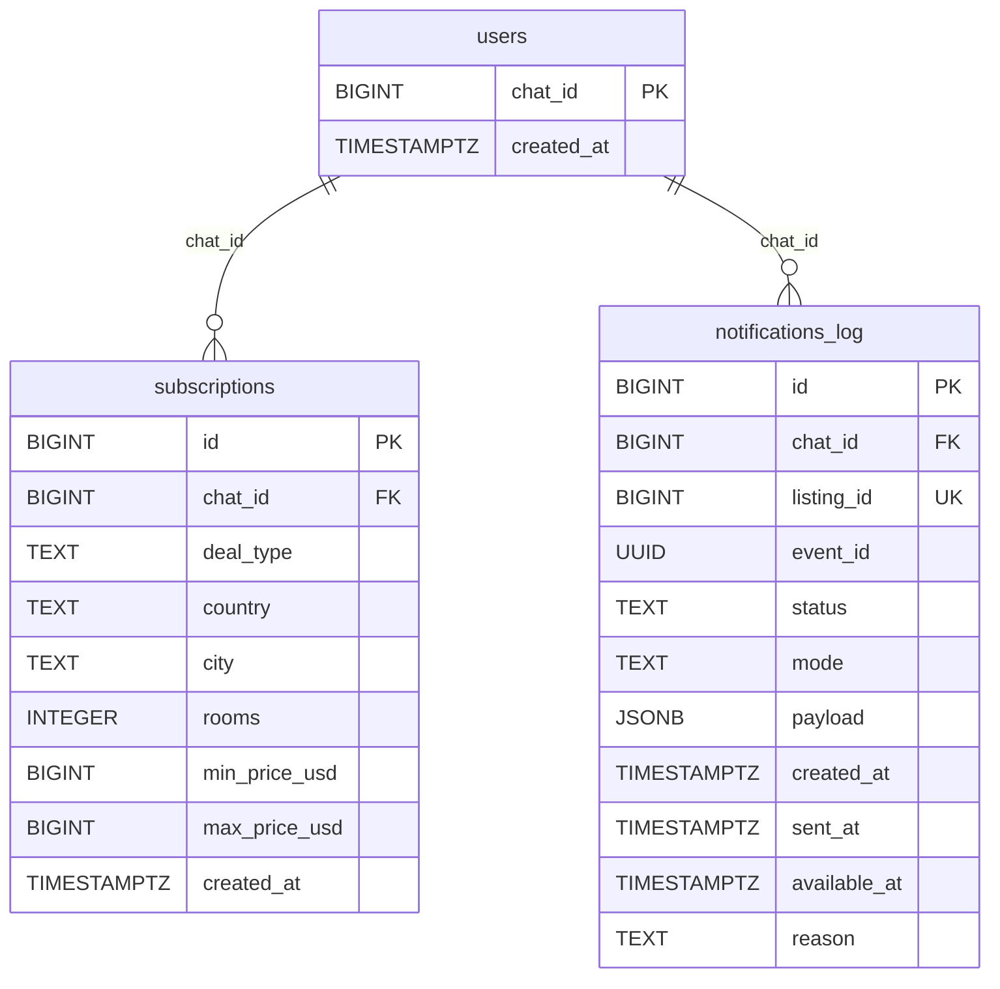

# ER-диаграмма схемы notifier

ТЗ v1.1, раздел 6.1 (ER-диаграмма — зона Ильи). Соответствует SQL-миграциям
notifier: `0001_init.sql`, `0002_available_at.sql`, `0003_reason.sql`
(reason — PR #132). Схема меняется только миграциями — диаграмма
обновляется вместе с ними. Диаграмма core — в [er-diagram.md](er-diagram.md).



Примечания:

- `notifications_log.listing_id` помечен `UK` условно — Mermaid не умеет
  составные UK, реальная уникальность составная
  `UNIQUE (chat_id, listing_id)` (одна запись на пару «пользователь ×
  объявление», дедуп журнала и отложенной очереди одновременно).
- `listing_id` — ID объявления из core **без межсхемного FK** (ТЗ 6.5:
  сервисы не ходят в чужую схему; ссылка логическая, по событию
  `listings.new`).
- `status` ограничен CHECK `notifications_log_status_chk`:
  `deferred` / `sent` / `failed` / `unknown`. `reason` заполняется только
  для финального неуспеха (`unknown`, `failed` — CHECK
  `notifications_log_reason_chk`): текст ошибки Telegram после потолка
  Retry-After либо причина карантина PopBatch (ТЗ 4.3).
- `available_at` — backoff отложенной очереди (миграция 0002): выборка
  PopBatch `WHERE status = 'deferred' AND available_at <= now()` идёт по
  частичному индексу `notifications_log_available_idx`.

## Как перегенерировать

```bash
python -I scripts/tools/sql-to-er.py --dir notifier/migrations
```

Без `-o` вывод в stdout — вставить в mermaid-блок выше. Дополнительных
корректировок генератору не требуется.
